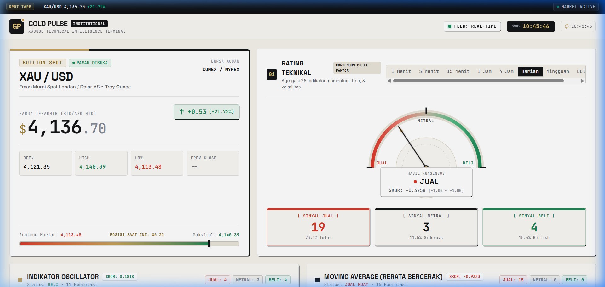
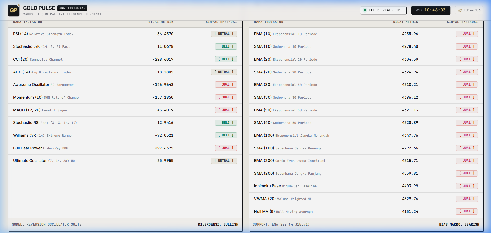

# 🥇 Gold Pulse — XAUUSD Technical Intelligence Terminal

> **Dashboard sinyal teknikal XAU/USD real-time** yang menampilkan 26 indikator teknikal lengkap dengan auto-refresh setiap **5 detik**. Data diambil langsung dari TradingView Scanner API — hampir real-time!


---

## 📸 Preview





---

## ❓ Apa Ini?

**Gold Pulse** adalah dashboard web yang menampilkan **sinyal teknikal XAU/USD (Emas / Dolar AS)** secara real-time. Dashboard ini mengambil data langsung dari TradingView Scanner API dan menampilkannya dalam tampilan yang mudah dibaca.

Semua data **auto-refresh setiap 5 detik** — jadi kamu cukup buka dashboard, dan data akan terus update sendiri tanpa perlu pencet apa-apa!

### Yang Bisa Dilihat:
- 📊 **Rating Teknikal** — Apakah pasar sedang sinyal BELI, JUAL, atau NETRAL
- ⚡ **11 Indikator Oscillator** — RSI, Stochastic, CCI, MACD, Awesome Oscillator, dll
- 📈 **15 Moving Average** — EMA/SMA dari period 10 sampai 200, plus Ichimoku, VWMA, Hull MA
- 🎯 **Pivot Points** — Classic, Fibonacci, Camarilla, Woodie, Demark
- ⏱️ **8 Timeframe** — 1 Menit, 5 Menit, 15 Menit, 1 Jam, 4 Jam, Harian, Mingguan, Bulanan
- 💰 **Harga Real-time** — Open, High, Low, Close, Change, + range bar harian

---

## 🚀 Cara Menjalankan

```bash
# 1. Clone repo ini
git clone https://github.com/AniffXP/gold-pulse.git
cd gold-pulse

# 2. Install dependencies
npm install

# 3. Jalankan
npm run dev
```

Buka `http://localhost:5173` di browser. Selesai! 🎉

---

## 🛠️ Tech Stack

| Teknologi | Fungsi |
|-----------|--------|
| **Vite** | Build tool super cepat + dev server + API proxy |
| **React** | UI component framework |
| **Tailwind CSS v4** | Styling utility-first |
| **TradingView Scanner API** | Sumber data teknikal real-time |

---

## 📁 Struktur Project

```
├── index.html          # Entry point HTML
├── vite.config.js      # Vite config + API proxy
├── package.json        # Dependencies
├── GoldPulse.bat       # Launcher Windows (double-click)
└── src/
    ├── App.jsx         # Semua komponen UI React
    ├── api.js          # Fetch data dari TradingView Scanner API
    ├── hooks.js        # Custom hooks (auto-refresh 5s, clock)
    ├── helpers.js      # Sinyal, format angka, kalkulasi
    ├── index.css       # Tailwind v4 + custom theme Swiss Editorial
    └── main.jsx        # React entry point
```

---

## ⚙️ Cara Kerja

1. **Vite dev server** berjalan di lokal dan mem-proxy request `/api/scan` ke `scanner.tradingview.com/cfd/scan`
2. **React** fetch data setiap 5 detik via custom hook `useTechnicalData`
3. Data di-parse dan ditampilkan di komponen-komponen UI (gauge, tabel, card)
4. **Tidak butuh API key** — TradingView Scanner API terbuka untuk public

---

## 📄 Lisensi

MIT — Bebas dipakai dan dimodifikasi.
